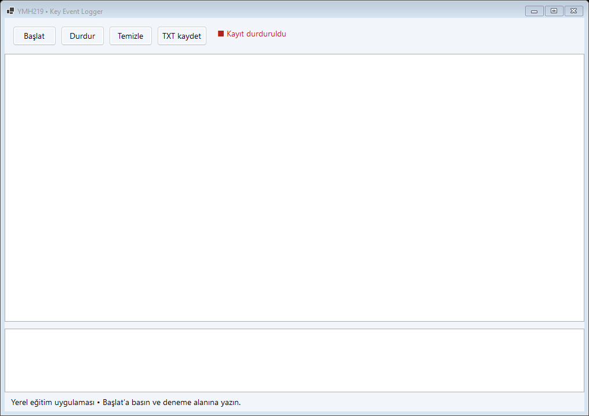
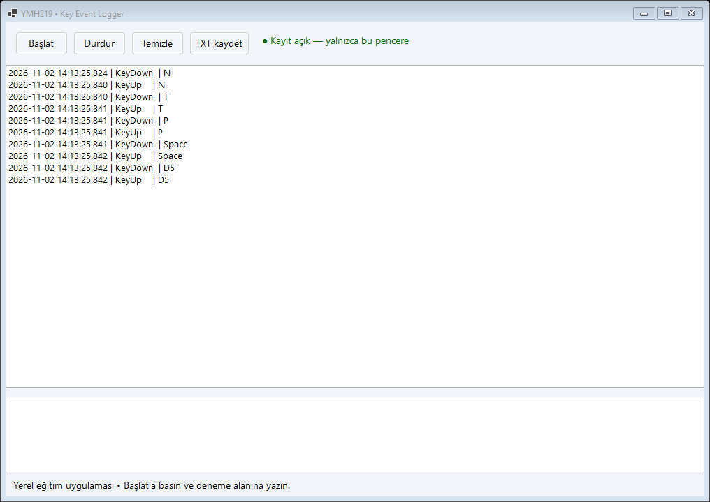

# Key Event Logger

YMH219 Nesne Tabanlı Programlama ek uygulama ödevi. C# ile geliştirilen Windows Forms masaüstü uygulaması.

## Teknolojiler
Windows x64, C#, .NET 10, Windows Forms. Ek NuGet paketi yok.

## Kurulum ve çalıştırma
1. .NET 10 SDK ve .NET 10 destekli Visual Studio (.NET masaüstü geliştirme iş yükü) kurun.
2. `KeyEventLogger.sln` dosyasını açın, NuGet paketlerini geri yükleyin ve F5 ile çalıştırın.
3. Alternatif: bu klasörde `dotnet run --project KeyEventLogger.csproj` çalıştırın.
4. Derleme kontrolü: `dotnet build KeyEventLogger.csproj -c Release`.

## Temel özellikler ve kullanım
Başlat ile kaydı açın, alttaki deneme alanında yazın. KeyDown/KeyUp olayları zaman damgasıyla listelenir. Durdur, Temizle ve TXT kaydet kullanılabilir.

## Ekran görüntüleri

## Sınırlamalar ve geliştirme notları
Yalnızca kendi formu odaktayken kayıt yapılır. Global hook, arka plan takibi ve ağ aktarımı yoktur. Bir tuş için basma ve bırakma ayrı olaylardır.

Arayüz MainForm, başlangıç Program, ortak görsel yardımcılar Ui sınıfındadır. Formların Dispose metotları kullanılan kaynakları temizler.

## Öğrenci bilgileri
- Ad soyad: **Talha Nuri Önder**
- Öğrenci numarası: **210541054**
